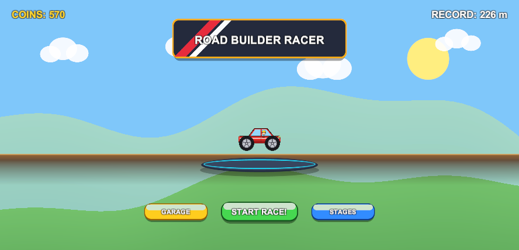
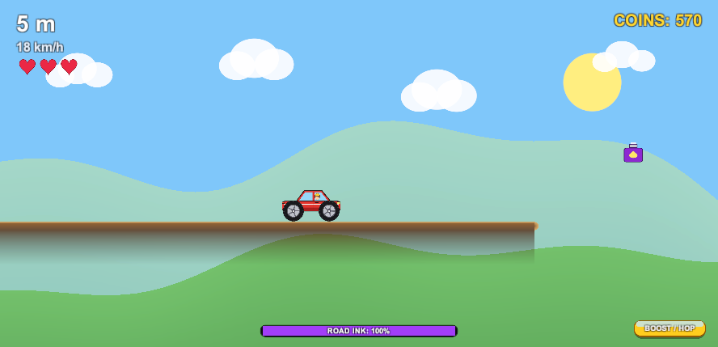
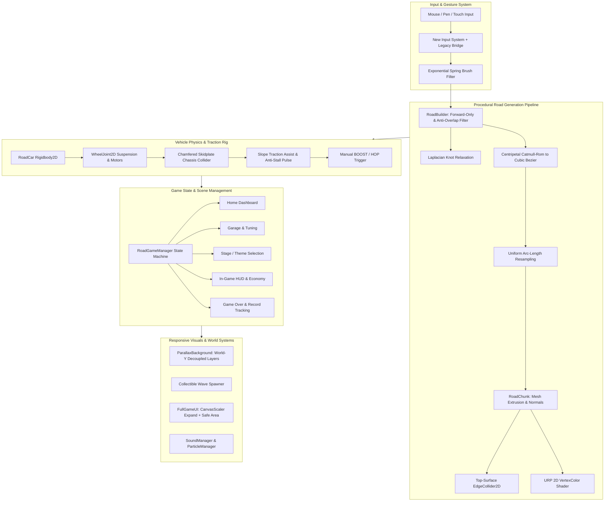
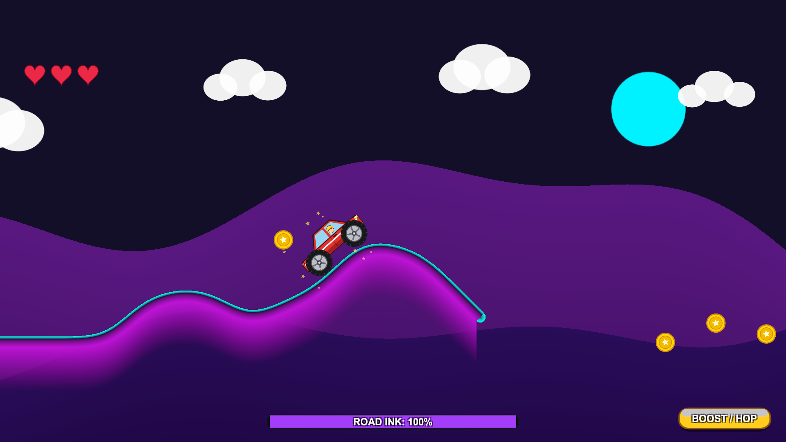
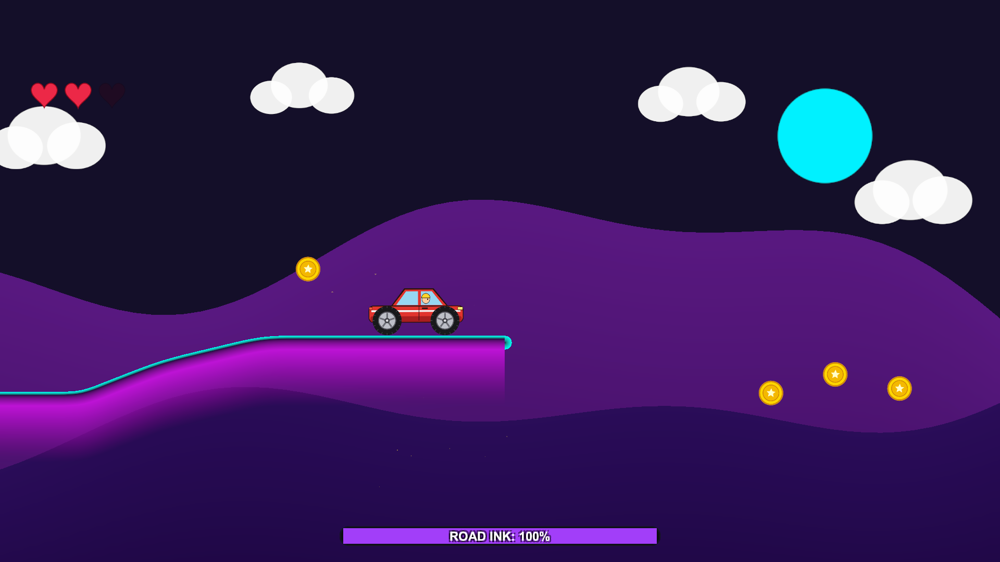

# Road Builder Racer — Architecture & Developer Handoff Document

> **Platform:** Mobile (Android & iOS) / Unity 6 (6000.3.20f1)  
> **Render Pipeline:** Universal Render Pipeline (URP 2D)  
> **Active Scene:** [`SampleScene.unity`](file:///Users/bsw-mm-036/Unity%20projects/New%20Game/Assets/Scenes/SampleScene.unity)  
> **Target Screen Aspects:** Responsive to all ratios ($21:9$ Ultrawide, $16:9$ Landscape, $4:3$ Tablet, $9:16$ Portrait) with Notch/Safe Area handling  

---

## 1. Executive Summary & Overview

**Road Builder Racer** is a mobile physics-platformer blending physics-driven vehicle simulation (reminiscent of *Hill Climb Racing*) with real-time interactive road drawing. Rather than driving on pre-constructed terrain, the player uses gestures to paint continuous, smoothly curved road ribbons ahead of the vehicle. If the road runs out or fails to bridge a gap, the car plunges into the chasm.




### Core Gameplay Loop
1. **Drive & Paint:** The player vehicle accelerates forward autonomously. The player uses touch/pen/mouse gestures to draw smooth asphalt, dirt, or neon ribbons.
2. **Ink Economy:** Drawing consumes ink proportional to distance. Ink regenerates continuously and can be replenished via collectible canisters.
3. **Collect & Upgrade:** Collect coins and hearts along predictable world arcs. Spend coins in the **Garage** on Engine (Speed), Suspension (Grip), and Ink Tank capacity, or unlock new vehicle archetypes.
4. **Environment Customization:** Choose between *Countryside Hills*, *Desert Dunes*, and *Cyber Night 2099*, along with corresponding road materials (*Asphalt Highway*, *Dirt Track*, *Neon Grid*).
5. **Fail-Safe & Respawn:** Recover from vehicle flips or chasm drops with an automated flat safety runway, eliminating instant-death loops.

---

## 2. High-Level Architecture Diagram



---

## 3. Road Generation Engine & Mathematics

The road engine lives across three scripts:
- [`BezierSpline.cs`](file:///Users/bsw-mm-036/Unity%20projects/New%20Game/Assets/Scripts/RoadBuilder/BezierSpline.cs)
- [`RoadBuilder.cs`](file:///Users/bsw-mm-036/Unity%20projects/New%20Game/Assets/Scripts/RoadBuilder/RoadBuilder.cs)
- [`RoadChunk.cs`](file:///Users/bsw-mm-036/Unity%20projects/New%20Game/Assets/Scripts/RoadBuilder/RoadChunk.cs)

### 3.1 Input Jitter Elimination (Exponential Spring Filter)
Raw touchscreen inputs suffer from micro-tremors and digitizer polling jitter. In [`RoadGameManager.cs`](file:///Users/bsw-mm-036/Unity%20projects/New%20Game/Assets/Scripts/RoadBuilder/RoadGameManager.cs#L515-L547), input is filtered through an exponential smoothing function:

$$P_{\text{smooth}}(t) = \mathrm{Lerp}\left(P_{\text{smooth}}(t-\Delta t),\, P_{\text{raw}}(t),\, 1 - e^{-k \cdot \Delta t}\right)$$

Where $k = 22.0$ (`brushSmoothingSpeed`). This preserves responsive gesture tracking while removing high-frequency jaggedness.

### 3.2 Real-Time 60 FPS Elastic Live Tip
Instead of waiting for the cursor to traverse the minimum distance before drawing anything, `RoadBuilder.UpdateLiveStrokeTip()` dynamically projects a provisional tip every frame. This creates a fluid ribbon feel under the player's finger.

### 3.3 Laplacian Knot Relaxation
Before constructing spline tangents, control knots undergo iterative Laplacian smoothing:

$$K_i^{(m+1)} = (1 - \lambda) K_i^{(m)} + \lambda \left(\frac{K_{i-1}^{(m)} + K_{i+1}^{(m)}}{2}\right)$$

Endpoints $K_0$ and $K_{n-1}$ remain pinned. This eliminates sharp kinks while preserving the overall stroke path.

### 3.4 Centripetal Catmull-Rom to Cubic Bézier Conversion
Standard uniform Catmull-Rom splines frequently generate cusps, loops, and overshoots when knots are spaced irregularly (common when drawing fast vs. slow). We use **Centripetal parameterization** ($\alpha = 0.5$):

$$t_{i+1} = t_i + \|P_{i+1} - P_i\|^{0.5}$$

Hermite tangents $m_1, m_2$ are computed centripetally and converted directly into Cubic Bézier control points:

$$B_0 = P_1, \quad B_1 = P_1 + \frac{m_1}{3}, \quad B_2 = P_2 - \frac{m_2}{3}, \quad B_3 = P_2$$

Cubic Bézier evaluation on $t \in [0, 1]$:

$$B(t) = (1-t)^3 B_0 + 3(1-t)^2 t B_1 + 3(1-t) t^2 B_2 + t^3 B_3$$

### 3.5 Uniform Arc-Length Resampling
To prevent physics edge colliders from bunching or stretching, `ResampleUniformArcLength` walks the spline and inserts points at exact uniform intervals of $0.16\text{ m}$.

### 3.6 Forward-Only Progression & Anti-Overlap Rules
To prevent cars from getting trapped in loops or colliding with backward-drawn roads:
- **`FrontierMaxX` Tracking:** The system tracks the furthest forward extent of all road segments.
- **Strict $+X$ Monotonicity:** Any gesture knot moving backward ($x \le x_{\text{prev}} + 0.14\text{ m}$) is rejected.
- **Slope & Curvature Clamping:** Slopes are clamped to $[-45^\circ, +45^\circ]$ and inter-span turns to $\le 32^\circ$.
- **Seamless Endpoint Welding (`snapRadius = 1.65m`):** Tapping near the frontier road tip seamlessly extends the existing segment without creating overlapping collider seams.

### 3.7 Top-Surface Collider & Mesh Ribbon Extrusion
In [`RoadChunk.cs`](file:///Users/bsw-mm-036/Unity%20projects/New%20Game/Assets/Scripts/RoadBuilder/RoadChunk.cs#L75-L165):
- Normals are smoothed using a 3-tap moving average.
- Four vertex layers are extruded per knot:
  1. $V_0$: Top curb boundary
  2. $V_1$: Curb-to-asphalt step
  3. $V_2$: Lower roadbed boundary
  4. $V_3$: Soft shadow skirt draping vertically downward
- **Collider Alignment:** The `EdgeCollider2D` points are placed along the upper surface ($P + N \cdot (\frac{1}{2}\text{thickness} - 0.03\text{m})$), ensuring vehicle tyres ride smoothly on the top curb.
- **Rounded End-Caps:** Both endpoints are sealed with semicircular mesh fans to avoid harsh cutoffs.

---

## 4. Vehicle Physics & Anti-Stall Systems

The vehicle simulation is implemented in [`RoadCar.cs`](file:///Users/bsw-mm-036/Unity%20projects/New%20Game/Assets/Scripts/RoadBuilder/RoadCar.cs).



### 4.1 Rig Architecture
- **Chassis:** `Rigidbody2D` with low center of mass ($y = -0.25\text{ m}$), continuous collision detection, and interpolated physics.
- **Chamfered Skidplate Collider:** The `PolygonCollider2D` features 10 vertices with steep angle chamfers at the front and rear bumpers, combined with a frictionless material (`friction = 0.0`). This ensures concave road valleys never snag the vehicle chassis.
- **Suspension:** Two `WheelJoint2D` instances configured at $90^\circ$ angles with $6.5\text{ Hz}$ frequency and $0.8$ damping ratio.
- **Tyres:** High-grip physics material (`friction = 2.4`).

### 4.2 Drive & Traction Systems
1. **Dual Motor Propulsion:** Powered by both active `WheelJoint2D.motor` (`maxMotorTorque = 340-520 Nm`) and direct rotational torque applied to the wheel bodies.
2. **Hill-Climb Traction Assist:** When wheels or chassis touch the road on steep inclines and forward velocity drops below target speed, an assist force is applied along the car's forward vector:

$$F_{\text{assist}} = \vec{D}_{\text{forward}} \cdot \left(F_{\text{hill}} \cdot \mathrm{Clamp01}\left(\frac{V_{\text{target}} - V_{\text{actual}}}{V_{\text{target}}}\right) \cdot M_{\text{car}}\right)$$

3. **Automatic Unstick Hop:** If vehicle velocity drops below $0.65\text{ m/s}$ for $>0.45\text{ s}$ while driving, `NudgeUnstick()` automatically applies a forward-upward impulse ($v_x = \max(V_{\text{target}} \cdot 0.75, 3.8), v_y = 4.2$) and levels vehicle pitch.
4. **Manual Boost Button:** Players can tap the **BOOST / HOP** button on the HUD at any time for manual recovery.

### 4.3 Fail-Safe Recovery Runway


When the car loses a life (driver head impact or chasm fall):
1. `RoadBuilder.CreateSafetyPlatformAndFindRespawn()` builds a flat $6\text{ m}$ safety platform at the current frontier.
2. The vehicle is placed cleanly upright on top of this platform with zero velocity.
3. 2.5 seconds of visual invincibility are triggered, preventing chained respawn loops.

---

## 5. Responsive UI & Multi-Aspect Architecture

The UI is built with Unity UI (uGUI) and inspectable in [`SampleScene.unity`](file:///Users/bsw-mm-036/Unity%20projects/New%20Game/Assets/Scenes/SampleScene.unity) under `FullGameUI`.

### 5.1 Screen Match Mode: Expand
The root canvas uses:
- **Reference Resolution:** $1920 \times 1080$
- **Screen Match Mode:** `Expand`

Unlike `MatchWidthOrHeight = 1` (which clips horizontal UI on narrow screens), `Expand` guarantees all menu panels, stat rows, and HUD elements stay visible on screens ranging from $21:9$ ultrawide down to $4:3$ tablets and $9:16$ portrait phones.

### 5.2 Dynamic Safe Area & Aspect Adaptation
In [`RoadGameManager.cs`](file:///Users/bsw-mm-036/Unity%20projects/New%20Game/Assets/Scripts/RoadBuilder/RoadGameManager.cs#L225-L285), `UpdateResponsiveLayout()` runs dynamically:
1. **Notch / Island Protection:** Maps `Screen.safeArea` directly to normalized anchors for `Panel_Home` and `Panel_HUD`, preventing camera notches or pill cutouts from overlapping buttons.
2. **Anchor-Matched Pivots:** Text elements use corner-specific pivots (`(0, 1)` for upper-left, `(1, 1)` for upper-right), keeping counters aligned to the screen corners.
3. **Adaptive Camera Look-Ahead:** On aspect ratios narrower than $1.5$ ($3:2$, $4:3$, or portrait), the camera orthographic size scales up automatically so the forward road-drawing area is never constricted.

---

## 6. Environment & Collectible Decoupling

- **World-Y Decoupled Parallax ([`ParallaxBackground.cs`](file:///Users/bsw-mm-036/Unity%20projects/New%20Game/Assets/Scripts/RoadBuilder/ParallaxBackground.cs)):** The celestial body (Sun/Moon), cloud layers, and rolling hills use independent horizontal ($0.10, 0.28$) and vertical ($0.88, 0.75$) parallax factors anchored in world space. Camera vertical movement dampens smoothly, preventing the backdrop from whipping during vehicle falls.
- **Predictable Collectible Arcs ([`RoadGameManager.cs`](file:///Users/bsw-mm-036/Unity%20projects/New%20Game/Assets/Scripts/RoadBuilder/RoadGameManager.cs#L585-L665)):** Coins, ink canisters, and hearts spawn along a continuous, world-space sine wave ahead of the vehicle ($1.4\text{m} + \sin(0.14x) \cdot 1.35\text{m}$). Coins appear in 3-coin jump arcs, giving players clear targets to draw roads toward.

---

## 7. Scene Hierarchy & Component Map

The active scene is [`SampleScene.unity`](file:///Users/bsw-mm-036/Unity%20projects/New%20Game/Assets/Scenes/SampleScene.unity). All core GameObjects exist permanently in the hierarchy:

| Hierarchy Root | Components | Purpose |
|:---|:---|:---|
| `Main Camera` | `Camera`, `AudioListener`, `UniversalAdditionalCameraData` | Orthographic 2D camera with aspect-adaptive scaling |
| `Global Light 2D` | `Light2D` | URP 2D ambient illumination |
| `EventSystem` | `EventSystem`, `InputSystemUIInputModule`, `StandaloneInputModule` | Dual-mode input dispatcher for mouse, pen, and touch |
| `RoadGame` | [`RoadGameManager.cs`](file:///Users/bsw-mm-036/Unity%20projects/New%20Game/Assets/Scripts/RoadBuilder/RoadGameManager.cs) | Master state machine, economy, HUD, and menu orchestration |
| `Road` | [`RoadBuilder.cs`](file:///Users/bsw-mm-036/Unity%20projects/New%20Game/Assets/Scripts/RoadBuilder/RoadBuilder.cs) | Stroke intake, spline sampling, and segment lifecycle |
| `Background` | [`ParallaxBackground.cs`](file:///Users/bsw-mm-036/Unity%20projects/New%20Game/Assets/Scripts/RoadBuilder/ParallaxBackground.cs) | Parallax mesh hill generation, sky, clouds, celestial bodies |
| `SoundManager` | [`SoundManager.cs`](file:///Users/bsw-mm-036/Unity%20projects/New%20Game/Assets/Scripts/RoadBuilder/SoundManager.cs) | Procedural audio synthesis for coins, engine, crashes, and drawing |
| `ParticleManager`| [`ParticleManager.cs`](file:///Users/bsw-mm-036/Unity%20projects/New%20Game/Assets/Scripts/RoadBuilder/ParticleManager.cs)| Particle bursts for road drawing, crashes, and pickups |
| `FullGameUI` | `Canvas`, `CanvasScaler`, `GraphicRaycaster` | Root responsive UI canvas containing all menu and HUD panels |

---

## 8. File Structure & Asset Inventory

```
Assets/
├── Scenes/
│   └── SampleScene.unity                    # Main production scene
├── Scripts/RoadBuilder/
│   ├── RoadGameManager.cs                   # Game controller, state machine, UI binding
│   ├── RoadBuilder.cs                       # Forward-only stroke filter & segment manager
│   ├── RoadChunk.cs                         # Dynamic ribbon mesh builder & EdgeCollider2D
│   ├── RoadCar.cs                           # Vehicle physics, wheel motors, traction assist
│   ├── BezierSpline.cs                      # Centripetal Catmull-Rom & Laplacian smoothing
│   ├── ParallaxBackground.cs                # Multi-layer procedural parallax terrain
│   ├── SoundManager.cs                      # Audio synthesizers & SFX channels
│   ├── ParticleManager.cs                   # 2D particle burst effects
│   ├── Collectible.cs                       # Coin, Ink canister, and Heart pickups
│   └── SpriteFactory.cs                     # Texture and procedural sprite generator
├── Shaders/
│   └── VertexColorUnlit.shader              # URP 2D unlit vertex color road shader
└── Resources/RoadBuilder/
    ├── CarBody.png / SportCarBody.png / MonsterTruckBody.png
    ├── Wheel.png / Coin.png / Heart.png / InkCanister.png / Star.png
    ├── Art/ (GameLogoBanner, Podium, Stage previews, Custom Buttons, StatBarBg)
    └── UI/ (InkFrame, Prev/Next buttons)
```

---

## 9. Developer & Designer Handoff Guide

### 9.1 Running the Project
1. Open the project in **Unity 6 (6000.3.20f1)**.
2. Open [`SampleScene.unity`](file:///Users/bsw-mm-036/Unity%20projects/New%20Game/Assets/Scenes/SampleScene.unity).
3. Press **Play**. Use the mouse or touchscreen to draw roads ahead of the vehicle.

### 9.2 Tuning Gameplay Parameters
Select `RoadGame` in the Hierarchy and adjust the fields in [`RoadGameManager.cs`](file:///Users/bsw-mm-036/Unity%20projects/New%20Game/Assets/Scripts/RoadBuilder/RoadGameManager.cs):
- **Start / Max Speed:** `baseStartSpeed` ($4.2$), `baseMaxSpeed` ($11.5$).
- **Ink Capacity & Regen:** `maxInk` ($100$), `inkCostPerMeter` ($1.2$), `inkRegenPerSec` ($5.0$).
- **Brush Smoothing:** `brushSmoothingSpeed` ($22.0$) — lower values make drawn curves broader; higher values track fast finger motions more tightly.

Select `Road` in the Hierarchy and adjust [`RoadBuilder.cs`](file:///Users/bsw-mm-036/Unity%20projects/New%20Game/Assets/Scripts/RoadBuilder/RoadBuilder.cs):
- **Road Thickness:** `roadThickness` ($0.38$) and `supportDepth` ($1.35$).
- **Turn Angle Limit:** `maxTurnAngleDegrees` ($32^\circ$) — controls the maximum allowed sharpness of road dips and crests.
- **Snap Radius:** `snapRadius` ($1.65\text{ m}$) — threshold for welding new strokes onto the existing road end.

### 9.3 Adding New Vehicles
1. Place the body texture in `Assets/Resources/RoadBuilder/<YourCarBody>.png`.
2. Open [`RoadCar.cs`](file:///Users/bsw-mm-036/Unity%20projects/New%20Game/Assets/Scripts/RoadBuilder/RoadCar.cs):
   - Add a new entry to `enum VehicleType`.
   - In `Build()`, add an `else if (type == VehicleType.YourCar)` block setting `bodyPath`, width `w`, height `h`, wheel radius `wr`, mass, torque, and wheel anchors.
3. In [`RoadGameManager.cs`](file:///Users/bsw-mm-036/Unity%20projects/New%20Game/Assets/Scripts/RoadBuilder/RoadGameManager.cs), add cost and unlock logic inside `GetVehicleCost()`.

### 9.4 Adding New Environments & Road Styles
1. In [`ParallaxBackground.cs`](file:///Users/bsw-mm-036/Unity%20projects/New%20Game/Assets/Scripts/RoadBuilder/ParallaxBackground.cs), add to `enum EnvironmentTheme` and define color palettes inside `ApplyTheme()`.
2. In [`RoadChunk.cs`](file:///Users/bsw-mm-036/Unity%20projects/New%20Game/Assets/Scripts/RoadBuilder/RoadChunk.cs), add to `enum RoadStyle` and specify curb, roadbed, under-layer, and fade colors inside `Build()`.
3. In [`RoadGameManager.cs`](file:///Users/bsw-mm-036/Unity%20projects/New%20Game/Assets/Scripts/RoadBuilder/RoadGameManager.cs), add stage preview card metadata inside `UpdateStageUI()`.

### 9.5 Building for Mobile (Android / iOS)
- **Input System:** Both New Input System and Legacy inputs are enabled (`activeInputHandler: 2`).
- **Orientation:** Best configured in **Landscape Left** / **Landscape Right** (or Auto Rotation). The UI dynamically adjusts if portrait is selected.
- **Graphics API:** URP 2D is configured using Metal on iOS and Vulkan/GLES3 on Android. All road shaders compile via [`VertexColorUnlit.shader`](file:///Users/bsw-mm-036/Unity%20projects/New%20Game/Assets/Shaders/VertexColorUnlit.shader).

