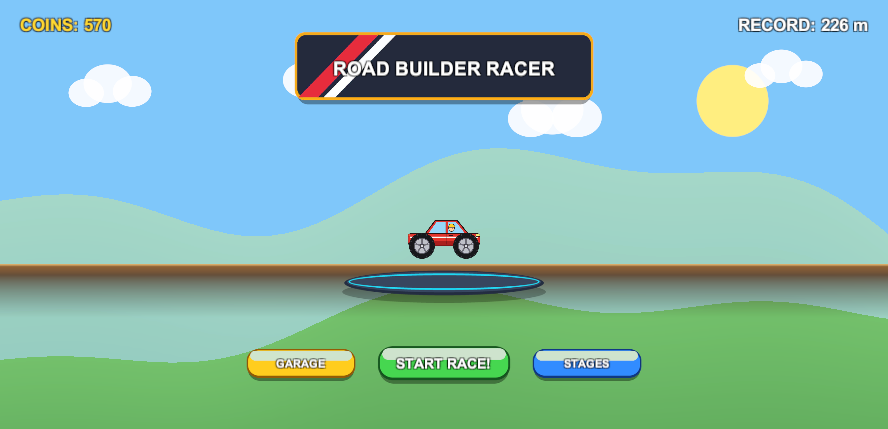
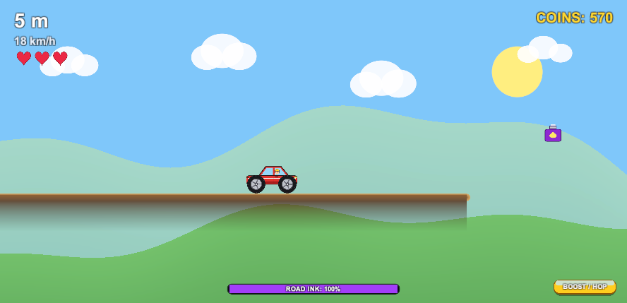

# Road Builder Racer

A mobile physics-platformer for Unity 6 (URP 2D) where players draw their own roads in real time using smooth splines while driving across customizable terrains.

## Quick Start
- **Engine:** Unity 6 (`6000.3.20f1`) with Universal Render Pipeline (URP 2D)
- **Active Scene:** [`Assets/Scenes/SampleScene.unity`](file:///Users/bsw-mm-036/Unity%20projects/New%20Game/Assets/Scenes/SampleScene.unity)
- **Controls:** Click/drag with mouse, pen, or touch to paint roads forward. Tap **BOOST / HOP** in the lower-right corner to pop over obstacles or unstick from dips.

## Detailed Documentation
Complete architecture diagrams, mathematical formulations, component workflows, and handoff instructions are documented in:
👉 **[`Docs/ARCHITECTURE_AND_HANDOFF.md`](file:///Users/bsw-mm-036/Unity%20projects/New%20Game/Docs/ARCHITECTURE_AND_HANDOFF.md)**

### Document Sections:
1. **Overview & Core Gameplay Loop**
2. **System Architecture & Component Diagram**
3. **Road Generation Engine & Mathematics** (Laplacian knot relaxation, Centripetal Catmull-Rom to Cubic Bézier, uniform arc-length resampling, forward-only anti-overlap rules)
4. **Vehicle Physics & Anti-Stall Systems** (Chamfered skidplate chassis collider, dual motors, hill-climb traction assist, automated safety runway respawn)
5. **Responsive UI & Multi-Aspect Engine** (`CanvasScaler` Expand mode, dynamic safe area notch handling, anchor-matched pivots, adaptive camera)
6. **Decoupled Environments & Collectibles** (World-Y decoupled parallax, predictable sine wave pickup arcs)
7. **Scene Hierarchy & Component Map**
8. **File Structure & Asset Inventory**
9. **Developer & Designer Handoff Guide** (Tuning parameters, adding cars, adding environments, building APK/IPA)

